# 数据模型与状态机

## 1. 实体关系

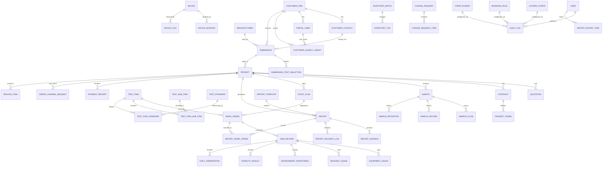

关系口径：

- 一个送检单可拆成多个项目。
- 一个项目必须且只能来源于一个送检单。
- 一个项目可包含多个样品、多个试验计划、多个工单。
- 一个试验计划可下发多个工单。
- 一个工单对应一个检测项目或检测子项组合。
- 一份报告可覆盖多个工单，使用 `report_work_order` 建多对多关系。
- 一个项目可生成多个报告版本，但同一时间只能有一个正式有效报告版本。
- 一个项目可有多笔收款记录，付款门禁按项目或报告汇总判断。
- 客户代理或跨单位账号必须通过 `customer_agency_grant` 授权。
- 协议、样品、项目和报告关键字段变更统一落到 `change_request`，旧系统的分散变更列表只作为筛选视图。
- 留样作为样品生命周期独立实体，不再只作为样品备注。
- 报告注册中心由 `report`、`report_version`、`report_delivery_log` 和 `archive_item` 组合提供。

## 2. 核心实体字段

所有业务表均继承 `00_技术栈与工程约定.md` 中的审计字段。下列表格只列业务字段。

### 2.1 客户单位 `customer_org`

送检单 CSV 中 `entity=customer_org` 的 sponsor 字段落到本表。DTO 可以保留 `sponsorNameZh` 这类送检单原始字段名，但落库字段统一为 `name_zh`、`address_zh` 等。

| 字段 | 类型 | 必填 | 说明 |
| --- | --- | --- | --- |
| `name_zh` | varchar(255) | 是 | 委托单位中文名称 |
| `name_en` | varchar(255) | 否 | 委托单位英文名称 |
| `address_zh` | text | 是 | 委托单位中文地址 |
| `address_en` | text | 否 | 委托单位英文地址 |
| `industry` | varchar(128) | 否 | 行业 |
| `grade` | varchar(64) | 否 | 客户等级 |
| `tax_no` | varchar(64) | 否 | 税号 |
| `invoice_title` | varchar(255) | 否 | 发票抬头 |
| `bank_account` | varchar(255) | 否 | 开票或收款相关账户信息 |
| `status` | varchar(32) | 是 | `ACTIVE`、`INACTIVE` |

### 2.2 客户联系人 `customer_contact`

| 字段 | 类型 | 必填 | 说明 |
| --- | --- | --- | --- |
| `customer_org_id` | uuid | 是 | 所属委托单位 |
| `contact_name` | varchar(128) | 是 | 联系人 |
| `phone` | varchar(64) | 是 | 电话 |
| `email` | varchar(255) | 是 | 联系人邮箱 |
| `is_primary` | boolean | 是 | 是否默认联系人 |
| `status` | varchar(32) | 是 | `ACTIVE`、`INACTIVE` |

### 2.3 制造商 `manufacturer`

| 字段 | 类型 | 必填 | 说明 |
| --- | --- | --- | --- |
| `name_zh` | varchar(255) | 是 | 制造商中文 |
| `name_en` | varchar(255) | 否 | 制造商英文 |
| `address_zh` | text | 是 | 制造商中文地址 |
| `address_en` | text | 否 | 制造商英文地址 |
| `status` | varchar(32) | 是 | `ACTIVE`、`INACTIVE` |

### 2.4 送检单 `submission`

送检单 Ver.15 的完整字段以 `specs/submission_ver15_fields.csv` 为权威。该 CSV 的 `entity` 列决定字段归属，代码生成不得自行重分配字段。

| 字段 | 类型 | 必填 | 说明 |
| --- | --- | --- | --- |
| `biz_no` | varchar(64) | 是 | `SUB-{yyyy}-{seq4}` |
| `customer_org_id` | uuid | 是 | 委托单位 |
| `customer_contact_id` | uuid | 是 | 联系人 |
| `manufacturer_id` | uuid | 是 | 制造商 |
| `applicant_user_id` | uuid | 是 | 提交人 |
| `status` | varchar(32) | 是 | 状态机 |
| `official_report_email` | varchar(512) | 是 | 电子报告官方接收邮箱 |
| `shipping_info` | text | 是 | 报告/发票寄送信息 |
| `requires_glp` | boolean | 是 | 是否需要 GLP 报告 |
| `requires_hard_copy_of_electronic_report` | boolean | 是 | 是否需要电子报告纸质盖章复印件 |
| `report_language` | varchar(16) | 是 | `CHS`、`ENG`、`BOTH` |
| `protocol_language` | varchar(16) | 是 | `CHS`、`ENG`、`BOTH` |
| `submitted_quantity_text` | varchar(255) | 是 | 客户原始数量描述 |
| `sample_disposition` | varchar(32) | 是 | 剩余样品处置 |
| `sample_disposition_remark` | text | 否 | 其他处置说明 |
| `change_locked_at` | timestamptz | 否 | 合同或方案签署后锁定 |
| `glp_characterization_affirmed` | boolean | 否 | GLP 样品表征确认 |
| `glp_characterization_confirmed_by` | varchar(128) | 否 | GLP 确认人 |
| `glp_characterization_confirmed_at` | timestamptz | 否 | GLP 确认时间 |

#### 2.4.1 送检单状态机

送检单状态用于承接客户草稿、提交、内部受理和项目拆分，不替代项目状态机。

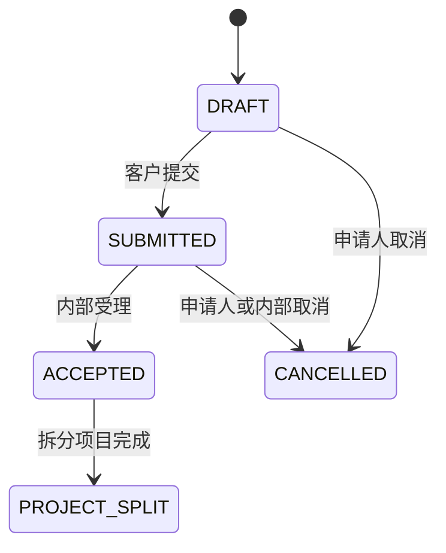

状态值必须来自 `specs/dictionaries.csv` 的 `SUBMISSION_STATUS`，代码不得临时新增送检单状态。

### 2.5 送检试验选择 `submission_test_selection`

| 字段 | 类型 | 必填 | 说明 |
| --- | --- | --- | --- |
| `submission_id` | uuid | 是 | 送检单 |
| `category` | varchar(32) | 是 | `BIOCOMPATIBILITY`、`MICROBIOLOGY`、`PACKAGING`、`PHYSICAL`、`CHEMICAL`、`OTHER` |
| `test_code` | varchar(64) | 是 | 来自 `specs/test_catalog.csv` |
| `test_name` | varchar(255) | 是 | 试验名称 |
| `method_name` | varchar(255) | 否 | 试验方法 |
| `extractant` | varchar(255) | 否 | 浸提介质 |
| `standard` | varchar(255) | 否 | 参照标准 |
| `instruction` | text | 否 | 送检说明 |
| `note` | text | 否 | 备注 |

### 2.6 项目 `project`

| 字段 | 类型 | 必填 | 说明 |
| --- | --- | --- | --- |
| `biz_no` | varchar(64) | 是 | `P-{yyyy}-{seq4}` |
| `submission_id` | uuid | 是 | 来源送检单 |
| `customer_org_id` | uuid | 是 | 委托单位 |
| `project_type` | varchar(32) | 是 | `STD_ACCREDITED`、`STD_NON_ACCREDITED`、`NON_STANDARD` |
| `qualification_type` | varchar(32) | 是 | `CMA`、`CNAS`、`CMA_CNAS`、`NONE` |
| `service_type` | varchar(32) | 是 | `NORMAL`、`URGENT` |
| `urgent_extra_fee_percent` | decimal(5,2) | 否 | 加急费比例 |
| `urgent_tat_days` | int | 否 | 加急承诺工作日 |
| `requires_glp` | boolean | 是 | 审批岔路字段 |
| `requires_animal_test` | boolean | 是 | 审批岔路字段 |
| `requires_ethics_review` | boolean | 是 | 通常由动物试验带出 |
| `requires_nonstandard_review` | boolean | 是 | 非标报价前门禁 |
| `business_owner_id` | uuid | 是 | 业务负责人 |
| `technical_owner_id` | uuid | 是 | 技术负责人 |
| `sd_user_id` | uuid | 是 | SD |
| `status` | varchar(32) | 是 | 状态机 |
| `planned_finish_at` | timestamptz | 否 | 计划完成时间 |
| `actual_finish_at` | timestamptz | 否 | 实际完成时间 |
| `health_status` | varchar(16) | 是 | `NORMAL`、`WARNING`、`RISK` |
| `health_score` | int | 是 | 0-100 |
| `payment_status` | varchar(32) | 是 | 付款汇总状态 |

### 2.7 样品 `sample`

样品字段与 `specs/submission_ver15_fields.csv` 中 `entity=sample` 的字段保持一致。

| 字段 | 类型 | 必填 | 说明 |
| --- | --- | --- | --- |
| `biz_no` | varchar(64) | 是 | `S-{yyyyMMdd}-{seq3}` |
| `project_id` | uuid | 是 | 项目 |
| `submission_id` | uuid | 是 | 来源送检单 |
| `sample_name_zh` | varchar(255) | 是 | 中文名称 |
| `sample_name_en` | varchar(255) | 是 | 英文名称 |
| `sterilization_state` | varchar(32) | 是 | 灭菌状态字典 |
| `cas_code` | varchar(128) | 是 | 不适用填 N/A |
| `model_ref` | varchar(255) | 是 | 型号 |
| `size_spec` | varchar(255) | 是 | 规格 |
| `lot_batch` | varchar(128) | 是 | 批号，报告后硬锁定 |
| `raw_material` | text | 是 | 样品材料 |
| `packaging_material` | text | 是 | 包装材料 |
| `physical_state` | varchar(64) | 是 | 物理状态 |
| `color` | varchar(128) | 是 | 颜色 |
| `density` | varchar(128) | 是 | 密度，保留单位 |
| `stability` | text | 是 | 稳定性 |
| `solubility` | text | 是 | 溶解度 |
| `storage_condition` | varchar(64) | 是 | 保存条件 |
| `intended_use` | text | 是 | 预期用途 |
| `additional_info` | text | 是 | 附加信息，进入报告 |
| `quantity` | decimal(12,3) | 是 | 数量 |
| `quantity_unit` | varchar(32) | 是 | 单位 |
| `status` | varchar(32) | 是 | 状态机 |
| `received_at` | timestamptz | 否 | 接收时间 |
| `received_by` | uuid | 否 | 样品管理员 |
| `inventory_location` | varchar(128) | 否 | 入库位置 |

### 2.8 生物相容性补充信息 `submission_biocompatibility`

| 字段 | 类型 | 必填 | 说明 |
| --- | --- | --- | --- |
| `submission_id` | uuid | 是 | 送检单 |
| `pretreatment_required` | text | 否 | 样品前处理要求 |
| `non_sterile_extra_procedure` | text | 条件必填 | 非灭菌样品额外消毒/灭菌程序 |
| `can_be_cut` | boolean | 是 | 是否可切割 |
| `components_to_test_zh` | text | 是 | 指定检测部位中文 |
| `components_to_test_en` | text | 是 | 指定检测部位英文 |
| `working_temperature_celsius` | varchar(64) | 是 | 工作温度 |
| `withstand_50c` | boolean | 是 | 是否耐受 50°C |
| `clinical_contact_duration` | varchar(32) | 是 | `A_LIMITED`、`B_PROLONGED`、`C_LONG_TERM` |
| `extraction_basis` | varchar(32) | 是 | `SURFACE_AREA`、`MASS`、`NA` |
| `standard_surface_area_cm2` | varchar(64) | 条件必填 | 表面积浸提时必填 |
| `thinnest_thickness_mm` | varchar(64) | 是 | 最薄处厚度 |
| `special_instructions` | text | 是 | 其他特别说明 |

### 2.9 检测标准 `test_standard`

检测标准来自现有系统“检测标准资源库”，是检测项目和报告依据的标准化参考体系。

| 字段 | 类型 | 必填 | 说明 |
| --- | --- | --- | --- |
| `standard_no` | varchar(128) | 是 | 标准编号 |
| `name_zh` | varchar(255) | 是 | 标准中文名称 |
| `name_en` | varchar(255) | 否 | 标准英文名称 |
| `version` | varchar(64) | 否 | 标准版本或年份 |
| `qualification_type` | varchar(32) | 是 | `CMA`、`CNAS`、`CMA_CNAS`、`NONE` |
| `status` | varchar(32) | 是 | `DRAFT`、`PUBLISHED`、`DISABLED` |

### 2.10 检测子项 `test_sub_item`

检测子项是标准化操作单元，用于组合成检测项目并生成工单。

| 字段 | 类型 | 必填 | 说明 |
| --- | --- | --- | --- |
| `code` | varchar(64) | 是 | 子项编码 |
| `name_zh` | varchar(255) | 是 | 子项中文名称 |
| `name_en` | varchar(255) | 否 | 子项英文名称 |
| `expected_duration_hours` | decimal(8,2) | 否 | 理论工时 |
| `department_id` | uuid | 否 | 默认执行部门 |
| `requires_equipment` | boolean | 是 | 是否需要设备 |
| `requires_inventory` | boolean | 是 | 是否需要标准品/试剂/耗材 |
| `status` | varchar(32) | 是 | `PRIVATE`、`PUBLISHED`、`DISABLED` |

### 2.11 检测项目 `test_item`

检测项目是面向客户和项目配置的检测方案，一个检测项目可包含多个检测子项，可关联多个检测标准。

| 字段 | 类型 | 必填 | 说明 |
| --- | --- | --- | --- |
| `code` | varchar(64) | 是 | 检测项目编码 |
| `name_zh` | varchar(255) | 是 | 检测项目中文名称 |
| `name_en` | varchar(255) | 否 | 检测项目英文名称 |
| `category` | varchar(32) | 是 | 生物相容性、微生物、包装、物理、化学、其他 |
| `default_project_type` | varchar(32) | 否 | 默认项目类型 |
| `requires_animal_test` | boolean | 是 | 是否通常涉及动物试验 |
| `requires_glp_optional` | boolean | 是 | 是否支持 GLP |
| `report_template_code` | varchar(64) | 否 | 默认报告模板 |
| `raw_record_template_code` | varchar(64) | 否 | 默认原始记录模板 |
| `status` | varchar(32) | 是 | `PRIVATE`、`PUBLISHED`、`DISABLED` |

`test_item_sub_item`

| 字段 | 类型 | 必填 | 说明 |
| --- | --- | --- | --- |
| `test_item_id` | uuid | 是 | 检测项目 |
| `test_sub_item_id` | uuid | 是 | 检测子项 |
| `sort_order` | int | 是 | 顺序 |
| `is_required` | boolean | 是 | 是否必需 |

`test_item_standard`

| 字段 | 类型 | 必填 | 说明 |
| --- | --- | --- | --- |
| `test_item_id` | uuid | 是 | 检测项目 |
| `test_standard_id` | uuid | 是 | 检测标准 |
| `usage_type` | varchar(32) | 是 | `TEST_BASIS`、`JUDGEMENT_BASIS`、`REFERENCE` |

### 2.12 试验计划 `study_plan`

| 字段 | 类型 | 必填 | 说明 |
| --- | --- | --- | --- |
| `biz_no` | varchar(64) | 是 | `PLAN-{yyyy}-{seq4}` |
| `project_id` | uuid | 是 | 项目 |
| `status` | varchar(32) | 是 | 状态机 |
| `requires_conditioning` | boolean | 是 | 是否置样 |
| `requires_glp` | boolean | 是 | 从项目带入 |
| `requires_animal_test` | boolean | 是 | 从项目带入 |
| `planned_start_at` | timestamptz | 否 | 计划开始 |
| `planned_finish_at` | timestamptz | 否 | 计划完成 |
| `sd_approved_at` | timestamptz | 否 | SD 审批 |
| `qa_approved_at` | timestamptz | 否 | QA 审批 |
| `ethics_approved_at` | timestamptz | 否 | 伦理审批 |

### 2.13 工单 `work_order`

| 字段 | 类型 | 必填 | 说明 |
| --- | --- | --- | --- |
| `biz_no` | varchar(64) | 是 | `WO-{yyyy}-{seq5}` |
| `study_plan_id` | uuid | 是 | 试验计划 |
| `project_id` | uuid | 是 | 冗余便于查询 |
| `sample_id` | uuid | 是 | 样品 |
| `test_item_id` | uuid | 是 | 检测项目 |
| `test_sub_item_id` | uuid | 否 | 具体执行子项，如工单拆到子项级 |
| `owner_user_id` | uuid | 是 | 唯一主责人 |
| `status` | varchar(32) | 是 | 状态机 |
| `progress_percent` | int | 是 | 0-100 |
| `last_progress_at` | timestamptz | 否 | 最近进展 |
| `planned_finish_at` | timestamptz | 否 | 计划完成 |

### 2.14 原始记录 `raw_record`

| 字段 | 类型 | 必填 | 说明 |
| --- | --- | --- | --- |
| `biz_no` | varchar(64) | 是 | `RR-{yyyy}-{seq5}` |
| `work_order_id` | uuid | 是 | 工单 |
| `project_id` | uuid | 是 | 冗余便于查询 |
| `sample_id` | uuid | 是 | 样品 |
| `template_code` | varchar(64) | 是 | 原始记录模板 |
| `test_item` | varchar(128) | 是 | 试验项目，如无菌 |
| `test_basis` | text | 是 | 检测依据 |
| `test_time` | varchar(128) | 否 | 检测时间，可存范围文本 |
| `test_location` | varchar(255) | 否 | 检测地点 |
| `temperature_celsius` | varchar(64) | 否 | 环境温度 |
| `humidity_percent` | varchar(64) | 否 | 环境湿度 |
| `method` | varchar(64) | 否 | 直接接种法、薄膜过滤法等 |
| `status` | varchar(32) | 是 | `DRAFT`、`SUBMITTED`、`REVIEWING`、`APPROVED`、`REJECTED` |
| `tester_id` | uuid | 是 | 检测人 |
| `checker_id` | uuid | 否 | 校核人 |

### 2.15 原始记录子表

`equipment_usage`

| 字段 | 类型 | 必填 | 说明 |
| --- | --- | --- | --- |
| `raw_record_id` | uuid | 是 | 原始记录 |
| `device_id` | uuid | 否 | 设备台账 |
| `device_name` | varchar(255) | 是 | 设备名称 |
| `device_no` | varchar(128) | 是 | 设备编号 |
| `model` | varchar(128) | 否 | 型号 |
| `calibration_valid_until` | date | 否 | 校准效期 |

`reagent_usage`

| 字段 | 类型 | 必填 | 说明 |
| --- | --- | --- | --- |
| `raw_record_id` | uuid | 是 | 原始记录 |
| `inventory_batch_id` | uuid | 否 | 标准品/试剂批次 |
| `reagent_name` | varchar(255) | 是 | 试剂名称 |
| `batch_no` | varchar(128) | 否 | 批号 |
| `expiry_date` | date | 否 | 有效期 |

`environment_monitoring`

| 字段 | 类型 | 必填 | 说明 |
| --- | --- | --- | --- |
| `raw_record_id` | uuid | 是 | 原始记录 |
| `monitoring_stage` | varchar(32) | 是 | `AFTER_DISINFECTION`、`DURING_OPERATION` |
| `plate1_cfu` | int | 否 | 皿 1 |
| `plate2_cfu` | int | 否 | 皿 2 |
| `plate3_cfu` | int | 否 | 皿 3 |
| `result` | varchar(32) | 是 | `PASS`、`FAIL` |

`sterility_result`

| 字段 | 类型 | 必填 | 说明 |
| --- | --- | --- | --- |
| `raw_record_id` | uuid | 是 | 原始记录 |
| `sample_name` | varchar(255) | 是 | 样品名 |
| `sample_no` | varchar(128) | 是 | 样品编号 |
| `sample_sequence` | varchar(64) | 否 | 样品序号 |
| `positive_control_result` | varchar(32) | 是 | `PASS`、`FAIL` |
| `sample_growth_result` | varchar(32) | 是 | `GROWTH`、`NO_GROWTH` |
| `conclusion` | varchar(32) | 是 | `STERILE`、`NON_STERILE`、`REVIEW_REQUIRED` |

`daily_observation`

| 字段 | 类型 | 必填 | 说明 |
| --- | --- | --- | --- |
| `raw_record_id` | uuid | 是 | 原始记录 |
| `medium` | varchar(32) | 是 | `FTM_30_35C`、`TSB_20_25C` |
| `culture_group` | varchar(64) | 是 | 供试品组、阳性对照、阴性对照 |
| `day_no` | int | 是 | 1-14 |
| `observation` | varchar(32) | 是 | `NEGATIVE`、`POSITIVE`、`NA` |
| `remark` | text | 否 | 备注 |

### 2.16 报告 `report`

| 字段 | 类型 | 必填 | 说明 |
| --- | --- | --- | --- |
| `biz_no` | varchar(64) | 是 | 报告编号 |
| `project_id` | uuid | 是 | 项目 |
| `report_template_id` | uuid | 否 | 报告模板外键；历史迁移数据允许为空 |
| `template_code` | varchar(64) | 是 | 报告模板 |
| `template_version` | varchar(32) | 是 | 模板版本 |
| `status` | varchar(32) | 是 | 状态机 |
| `current_version_no` | int | 是 | 当前正式或正在修订的版本号；发起重新签发时由报告服务递增 |
| `is_official` | boolean | 是 | 是否正式有效 |
| `watermark_type` | varchar(32) | 是 | `DRAFT`、`TEST`、`NONE` |
| `payment_gate_status` | varchar(32) | 是 | `LOCKED`、`UNLOCKED`、`GREEN_UNLOCKED` |
| `issued_at` | timestamptz | 否 | 签发时间 |
| `released_at` | timestamptz | 否 | 发放时间 |

说明：新生成报告应关联 `report_template_id`。`template_code` 和 `template_version` 作为冗余快照保留，用于历史查询、审计和迁移期模板软匹配。

### 2.17 报告版本和工单关系

`report_version`

| 字段 | 类型 | 必填 | 说明 |
| --- | --- | --- | --- |
| `report_id` | uuid | 是 | 报告 |
| `version_no` | int | 是 | 版本号 |
| `status` | varchar(32) | 是 | `DRAFT`、`ISSUED`、`VOIDED`、`SUPERSEDED` |
| `docx_file_id` | uuid | 否 | DOCX 文件 |
| `pdf_file_id` | uuid | 否 | PDF 文件 |
| `data_snapshot_file_id` | uuid | 否 | 渲染数据快照 |
| `revision_reason` | text | 否 | 重新签发原因 |
| `issued_at` | timestamptz | 否 | 签发时间 |

`report_work_order`

| 字段 | 类型 | 必填 | 说明 |
| --- | --- | --- | --- |
| `report_id` | uuid | 是 | 报告 |
| `work_order_id` | uuid | 是 | 工单 |
| `raw_record_id` | uuid | 否 | 关联原始记录 |

### 2.18 收款和付款条款

`payment_terms`

| 字段 | 类型 | 必填 | 说明 |
| --- | --- | --- | --- |
| `contract_id` | uuid | 是 | 合同 |
| `term_type` | varchar(32) | 是 | `PREPAID`、`BEFORE_REPORT`、`MONTHLY_SETTLEMENT`、`CUSTOM` |
| `ratio_percent` | decimal(5,2) | 否 | 比例 |
| `amount` | decimal(14,2) | 否 | 固定金额 |
| `due_event` | varchar(64) | 是 | 到期事件 |
| `remark` | text | 否 | 备注 |

`payment_receipt`

| 字段 | 类型 | 必填 | 说明 |
| --- | --- | --- | --- |
| `biz_no` | varchar(64) | 是 | 收款编号 |
| `project_id` | uuid | 是 | 项目 |
| `report_id` | uuid | 否 | 指定报告 |
| `amount` | decimal(14,2) | 是 | 金额 |
| `received_at` | timestamptz | 是 | 到账时间 |
| `received_by` | uuid | 是 | 财务人员 |
| `receipt_method` | varchar(32) | 是 | 转账、现金、其他 |
| `voucher_file_id` | uuid | 否 | 凭证附件 |
| `status` | varchar(32) | 是 | `RECORDED`、`REVERSED` |

### 2.19 样品退还 `sample_return`

| 字段 | 类型 | 必填 | 说明 |
| --- | --- | --- | --- |
| `sample_id` | uuid | 是 | 样品 |
| `project_id` | uuid | 是 | 项目 |
| `return_method` | varchar(32) | 是 | `COURIER`、`SELF_PICKUP`、`DESTROY` |
| `tracking_no` | varchar(128) | 否 | 快递单号 |
| `proof_file_id` | uuid | 否 | 签收或销毁凭证 |
| `handled_by` | uuid | 是 | 处理人 |
| `handled_at` | timestamptz | 是 | 处理时间 |
| `status` | varchar(32) | 是 | `PENDING`、`DONE`、`CANCELLED` |

### 2.20 代理授权 `customer_agency_grant`

| 字段 | 类型 | 必填 | 说明 |
| --- | --- | --- | --- |
| `portal_user_id` | uuid | 是 | 代理账号 |
| `customer_org_id` | uuid | 是 | 被代理委托单位 |
| `granted_by` | uuid | 是 | 授权人 |
| `valid_from` | date | 是 | 生效日期 |
| `valid_until` | date | 否 | 失效日期 |
| `scope` | varchar(64) | 是 | `SUBMIT_ONLY`、`VIEW_REPORTS`、`FULL_PORTAL` |
| `status` | varchar(32) | 是 | `ACTIVE`、`REVOKED`、`EXPIRED` |

### 2.21 业务规则 `business_rule`

用于把"GLP 必走 QA"、"动物试验必走伦理"、"两天无进展告警"等可调判断逻辑沉到表里，避免硬编码。详细使用约定见 [00 §7.2](00_技术栈与工程约定.md)。

| 字段 | 类型 | 必填 | 说明 |
| --- | --- | --- | --- |
| `rule_code` | varchar(64) | 是 | 规则代码，全局唯一，如 `PLAN_REQUIRES_QA` |
| `name_zh` | varchar(255) | 是 | 规则名称 |
| `trigger_type` | varchar(64) | 是 | 触发场景，如 `STUDY_PLAN_REVIEW_START`、`WORK_ORDER_DAILY_CHECK` |
| `condition_expr` | text | 是 | Aviator 表达式，输入上下文为业务实体 JSON |
| `action_code` | varchar(64) | 是 | 关联 `permission_matrix.csv` 中的 actionCode 或预定义动作 |
| `action_payload` | jsonb | 否 | 动作参数 |
| `priority` | int | 是 | 多规则匹配时的优先级 |
| `enabled` | boolean | 是 | 是否启用 |
| `note` | text | 否 | 备注 |

### 2.22 系统配置 `system_config`

存放可由后台编辑的系统参数，例如健康度阈值、设备预约规则、token TTL、归档保存年限等。完整清单见 [17 §3](17_修改生效SLA与可配置项清单.md)。

| 字段 | 类型 | 必填 | 说明 |
| --- | --- | --- | --- |
| `config_key` | varchar(128) | 是 | 配置键，全局唯一，如 `WORK_CENTER_STALE_DAYS` |
| `config_value` | text | 是 | 值，按 `value_type` 解析 |
| `value_type` | varchar(16) | 是 | `INT`、`DECIMAL`、`STRING`、`BOOLEAN`、`JSON` |
| `category` | varchar(64) | 是 | 分组，如 `WORK_CENTER`、`APPROVAL`、`NOTIFICATION`、`AUTH` |
| `editable_by_role` | varchar(64) | 是 | 可编辑此项的 roleCode，多个用逗号分隔 |
| `description_zh` | text | 否 | 用途说明 |

### 2.23 动态表单 `form_schema`

承载 formily 渲染所需 schema，按 `form_code + version_no` 寻址。送检单 Ver.15、原始记录、报告草稿、系统参数表单均通过此表加载。详见 [00 §9](00_技术栈与工程约定.md)。

| 字段 | 类型 | 必填 | 说明 |
| --- | --- | --- | --- |
| `form_code` | varchar(64) | 是 | 表单代码，如 `SUBMISSION_VER15`、`RAW_RECORD_STERILITY` |
| `version_no` | int | 是 | 版本号，全局递增 |
| `schema_json` | jsonb | 是 | formily JSON Schema |
| `ui_schema_json` | jsonb | 否 | 可选 UI Schema |
| `status` | varchar(32) | 是 | `DRAFT`、`PUBLISHED`、`DEPRECATED` |
| `published_at` | timestamptz | 否 | 发布时间 |
| `published_by` | uuid | 否 | 发布人 |
| `note` | text | 否 | 变更说明 |

约束：

- 同一 `form_code` 同一时间只允许一个 `PUBLISHED` 版本作为当前生效版本。
- 新发布版本必须先 `DRAFT` 再 `PUBLISHED`，旧版本自动 `DEPRECATED`。
- 进行中的填写会话保留旧版本 schema 直至提交，避免数据丢失。

### 2.24 审计日志 `audit_log`

所有写操作通过 Spring AOP 切面异步写入本表。审计日志不可物理删除，归档保留 6 年。

| 字段 | 类型 | 必填 | 说明 |
| --- | --- | --- | --- |
| `occurred_at` | timestamptz | 是 | 事件发生时间 |
| `actor_user_id` | uuid | 否 | 操作人，未登录或系统任务可为空 |
| `actor_role_code` | varchar(64) | 否 | 当时主导角色 |
| `client_type` | varchar(32) | 是 | `INTERNAL`、`PORTAL`、`MOBILE`、`SYSTEM` |
| `action_code` | varchar(64) | 是 | 来自 `permission_matrix.csv` 或预定义系统动作 |
| `entity_type` | varchar(64) | 否 | 业务实体类型，如 `project`、`report` |
| `entity_id` | uuid | 否 | 业务实体 ID |
| `entity_biz_no` | varchar(64) | 否 | 业务编号，便于人工排查 |
| `before_snapshot` | jsonb | 否 | 变更前快照 |
| `after_snapshot` | jsonb | 否 | 变更后快照 |
| `result` | varchar(16) | 是 | `SUCCESS`、`FAILURE` |
| `failure_reason` | text | 否 | 失败原因 |
| `ip` | varchar(64) | 否 | 来源 IP |
| `user_agent` | varchar(512) | 否 | 客户端 UA |
| `trace_id` | varchar(64) | 否 | 链路追踪 ID |

### 2.25 统一变更申请 `change_request`

承接旧系统协议变更、样品变更和后续项目/报告关键字段变更。页面可以按对象类型展示“协议变更申请列表”或“样品变更申请列表”，底层使用同一模型。

| 字段 | 类型 | 必填 | 说明 |
| --- | --- | --- | --- |
| `biz_no` | varchar(64) | 是 | `CR-{yyyy}-{seq5}` |
| `target_type` | varchar(64) | 是 | `SUBMISSION`、`CONTRACT`、`SAMPLE`、`PROJECT`、`REPORT` |
| `target_id` | uuid | 是 | 被变更实体 ID |
| `target_biz_no` | varchar(64) | 否 | 被变更实体业务编号 |
| `change_type` | varchar(64) | 是 | `FIELD_CORRECTION`、`SCOPE_CHANGE`、`COST_PERIOD_CHANGE`、`REPORT_CORRECTION`、`OTHER` |
| `reason` | text | 是 | 变更原因 |
| `status` | varchar(32) | 是 | 状态机 |
| `requested_by` | uuid | 是 | 申请人 |
| `requested_at` | timestamptz | 是 | 申请时间 |
| `effective_at` | timestamptz | 否 | 生效时间 |
| `attachment_file_id` | uuid | 否 | 客户确认、补充协议或说明附件 |

`change_request_item`

| 字段 | 类型 | 必填 | 说明 |
| --- | --- | --- | --- |
| `change_request_id` | uuid | 是 | 变更申请 |
| `field_path` | varchar(255) | 是 | 字段路径，如 `sample.lotBatch` |
| `field_label` | varchar(255) | 是 | 页面字段名 |
| `old_value` | text | 否 | 变更前值 |
| `new_value` | text | 否 | 变更后值 |
| `lock_policy` | varchar(32) | 是 | 变更时适用的锁定策略 |

约束：

- `HARD_LOCK` 字段在报告签发后不得直接生效，只能触发报告重新签发、作废或更正声明。
- `CHANGE_REQUEST` 字段必须审批通过后由领域服务统一写回目标实体。
- 变更生效必须写 `approval_record` 和 `audit_log`，不得由前端直接改目标表。

### 2.26 留样 `sample_retention`

留样作为样品生命周期独立实体，承接现有系统“留样管理”。

| 字段 | 类型 | 必填 | 说明 |
| --- | --- | --- | --- |
| `biz_no` | varchar(64) | 是 | 留样编号 |
| `sample_id` | uuid | 是 | 样品 |
| `project_id` | uuid | 是 | 项目 |
| `report_id` | uuid | 否 | 已出报告时关联报告 |
| `retained_quantity` | decimal(12,3) | 是 | 留样数量 |
| `quantity_unit` | varchar(32) | 是 | 单位 |
| `storage_condition` | varchar(64) | 是 | 保存条件 |
| `storage_location` | varchar(255) | 是 | 保存位置 |
| `retained_at` | timestamptz | 是 | 留样登记时间 |
| `retained_by` | uuid | 是 | 登记人 |
| `retain_until` | date | 否 | 保留至日期 |
| `disposition_plan` | varchar(32) | 是 | `RETURN`、`DESTROY`、`ARCHIVE`、`EXTEND` |
| `status` | varchar(32) | 是 | 状态机 |
| `proof_file_id` | uuid | 否 | 退还、销毁或延期凭证 |

### 2.27 报告模板 `report_template`

报告模板管理承接现有系统 16 类模板。一期不要求全部自动生成，但必须可注册、版本化、迁移和人工选用。

| 字段 | 类型 | 必填 | 说明 |
| --- | --- | --- | --- |
| `template_code` | varchar(64) | 是 | 模板代码 |
| `template_version` | varchar(32) | 是 | 模板版本 |
| `template_name` | varchar(255) | 是 | 模板名称 |
| `template_type` | varchar(64) | 是 | `CONTRACT_EXPORT`、`SAMPLE_FLOW_EXPORT`、`REPORT`、`EN_REPORT`、`SPECIAL_REPORT` |
| `automation_level` | varchar(16) | 是 | `A`、`B`、`C` |
| `file_id` | uuid | 是 | 模板文件 |
| `status` | varchar(32) | 是 | `DRAFT`、`PUBLISHED`、`DEPRECATED`、`DISABLED` |
| `published_at` | timestamptz | 否 | 发布时间 |
| `published_by` | uuid | 否 | 发布人 |
| `legacy_template_name` | varchar(255) | 否 | 旧系统模板名 |

### 2.28 报告发放日志 `report_delivery_log`

报告注册中心使用本表记录正式报告下载、客户查看、邮件发放、批量下载和绿色通道发放。

| 字段 | 类型 | 必填 | 说明 |
| --- | --- | --- | --- |
| `report_id` | uuid | 是 | 报告 |
| `report_version_id` | uuid | 是 | 报告版本 |
| `delivery_type` | varchar(32) | 是 | `PREVIEW`、`DOWNLOAD`、`EMAIL`、`BATCH_DOWNLOAD`、`GREEN_CHANNEL` |
| `delivered_to` | varchar(512) | 否 | 接收人或邮箱 |
| `delivered_by` | uuid | 否 | 操作人，客户自助下载可为空 |
| `delivered_at` | timestamptz | 是 | 发放或下载时间 |
| `client_type` | varchar(32) | 是 | `INTERNAL`、`PORTAL`、`MOBILE`、`SYSTEM` |
| `payment_gate_status` | varchar(32) | 是 | 当时付款门禁状态 |
| `file_id` | uuid | 否 | 实际发放文件 |

### 2.29 设备文件 `device_file`

设备文件绑定设备台账，不作为独立网盘。

| 字段 | 类型 | 必填 | 说明 |
| --- | --- | --- | --- |
| `device_id` | uuid | 是 | 设备 |
| `file_type` | varchar(64) | 是 | `MANUAL`、`CALIBRATION_CERT`、`VERIFICATION_CERT`、`MAINTENANCE_RECORD`、`SOP`、`TRAINING_RECORD`、`OTHER` |
| `file_id` | uuid | 是 | 文件 |
| `version_no` | varchar(32) | 否 | 文件版本 |
| `valid_from` | date | 否 | 生效日期 |
| `valid_until` | date | 否 | 失效或到期日期 |
| `is_current` | boolean | 是 | 是否当前有效 |
| `uploaded_by` | uuid | 是 | 上传人 |
| `uploaded_at` | timestamptz | 是 | 上传时间 |

### 2.30 导入导出任务 `import_export_task`

批量导入、批量导出、报告批量下载和迁移补录统一记录为任务，避免前端长时间同步执行。

| 字段 | 类型 | 必填 | 说明 |
| --- | --- | --- | --- |
| `biz_no` | varchar(64) | 是 | 任务编号 |
| `task_type` | varchar(64) | 是 | `MASTER_IMPORT`、`MIGRATION_IMPORT`、`LIST_EXPORT`、`REPORT_BATCH_DOWNLOAD`、`AUDIT_EXPORT` |
| `entity_type` | varchar(64) | 是 | 业务对象 |
| `status` | varchar(32) | 是 | `PENDING`、`VALIDATING`、`RUNNING`、`SUCCESS`、`FAILED`、`EXPIRED` |
| `requested_by` | uuid | 是 | 发起人 |
| `requested_at` | timestamptz | 是 | 发起时间 |
| `source_file_id` | uuid | 否 | 导入源文件 |
| `result_file_id` | uuid | 否 | 导出或错误清单文件 |
| `error_summary` | text | 否 | 错误摘要 |
| `expires_at` | timestamptz | 否 | 临时文件过期时间 |

### 2.31 旧状态映射 `legacy_status_mapping`

迁移专用表，用于把旧系统状态映射到新实体状态机。此表不参与新业务状态流转，只用于导入和迁移核验。

| 字段 | 类型 | 必填 | 说明 |
| --- | --- | --- | --- |
| `legacy_entity_type` | varchar(64) | 是 | 旧系统实体，如 `protocol`、`sample_flow`、`work_order` |
| `legacy_status_text` | varchar(128) | 是 | 旧状态文本 |
| `target_entity_type` | varchar(64) | 是 | 新实体，如 `project`、`sample`、`work_order`、`report` |
| `target_status` | varchar(64) | 是 | 新状态 |
| `migration_mode` | varchar(32) | 是 | `ACTIVE_FLOW`、`READONLY_ARCHIVE`、`MANUAL_REVIEW` |
| `quality_score_delta` | int | 是 | 对迁移质量评分的影响 |
| `note` | text | 否 | 映射说明 |

### 2.32 文件元数据 `file_metadata`

业务文件统一保存元数据，文件实体存对象存储。

| 字段 | 类型 | 必填 | 说明 |
| --- | --- | --- | --- |
| `file_name` | varchar(255) | 是 | 原始文件名 |
| `object_key` | varchar(512) | 是 | 对象存储 key |
| `content_type` | varchar(128) | 否 | MIME 类型 |
| `size_bytes` | bigint | 是 | 文件大小 |
| `sha256` | varchar(64) | 否 | 文件摘要 |
| `uploaded_by` | uuid | 否 | 上传人 |
| `uploaded_at` | timestamptz | 是 | 上传时间 |
| `retention_until` | date | 否 | 保留至日期 |

## 3. 项目状态机

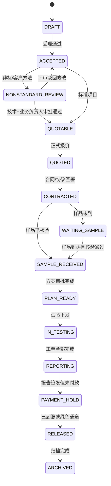

关键 guards：

- `NONSTANDARD_REVIEW -> QUOTABLE`：技术负责人和业务负责人均通过。
- `CONTRACTED -> WAITING_SAMPLE`：允许无样受理，但不得试验下发。
- `SAMPLE_RECEIVED -> PLAN_READY`：必要的 SD、QA、伦理审批均完成。
- `IN_TESTING -> REPORTING`：项目下所有必需工单均 `COMPLETED`。
- `REPORTING -> PAYMENT_HOLD`：QC、QA、SD、签发均完成。
- `PAYMENT_HOLD -> RELEASED`：已到账，或绿色通道只解锁电子正式报告。

## 4. 样品状态机

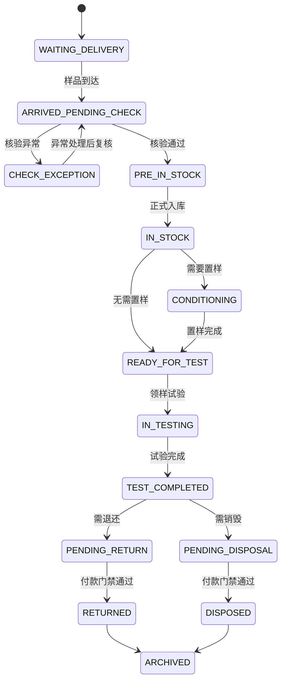

## 5. 试验计划状态机

待下发状态落在 `study_plan`，不是工单。资料不全时可形成 `PENDING_DISPATCH`，但不得生成可执行工单。

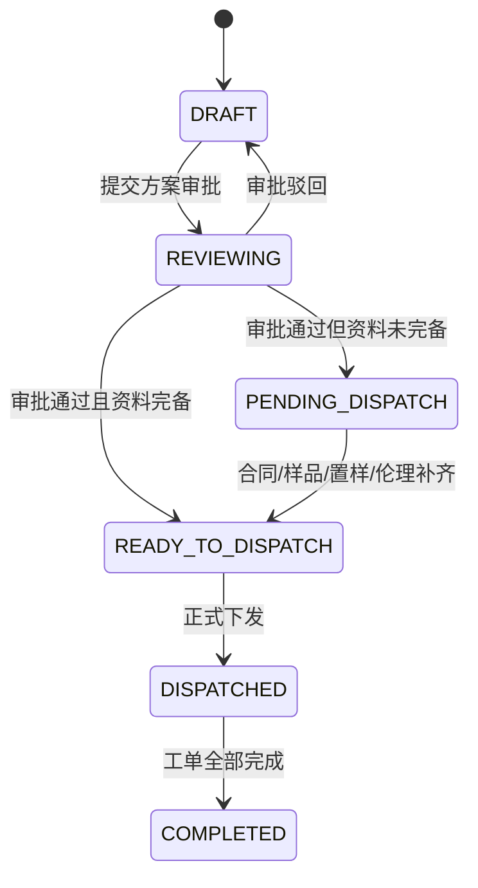

## 6. 工单状态机

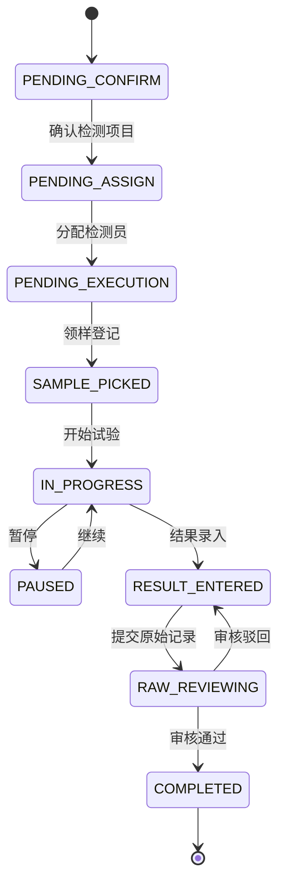

## 7. 报告状态机

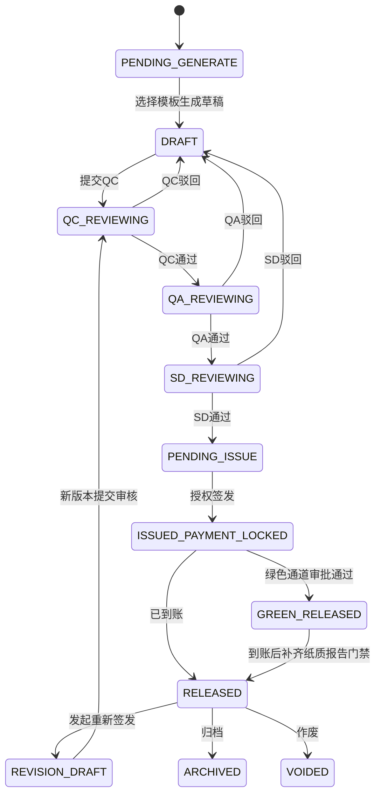

重新签发规则：

- `RELEASED -> REVISION_DRAFT` 必须创建新的 `report_version`。
- 发起重新签发时，报告服务先将 `report.current_version_no` 加 1，再创建对应版本号的 `report_version` 草稿。
- 原正式版本在新版本签发前仍为有效版本。
- 新版本签发后，旧版本状态改为 `SUPERSEDED`。
- 作废必须记录作废原因和审批记录。

## 8. 绿色通道状态机

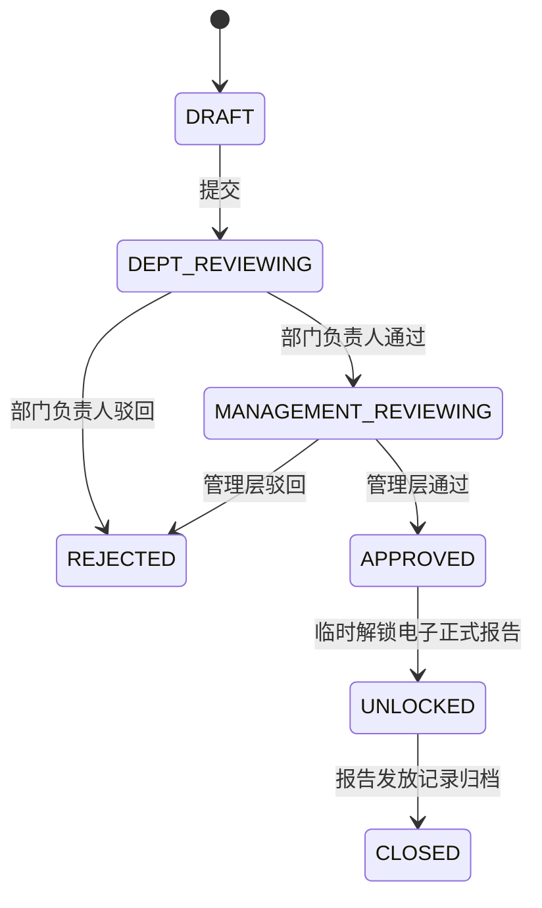

## 9. 设备预约状态机

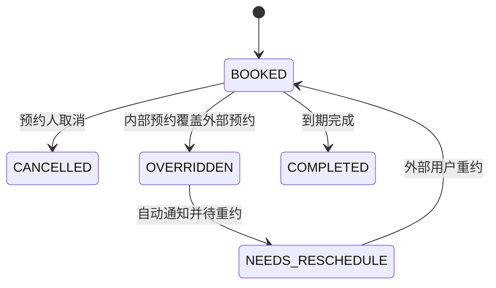

默认动作：

- 内部覆盖外部预约时，系统发送站内消息和邮件。
- 被覆盖预约自动进入 `NEEDS_RESCHEDULE`。
- 覆盖操作必须记录原因、操作人和被覆盖预约。

## 10. 标准品批次状态机

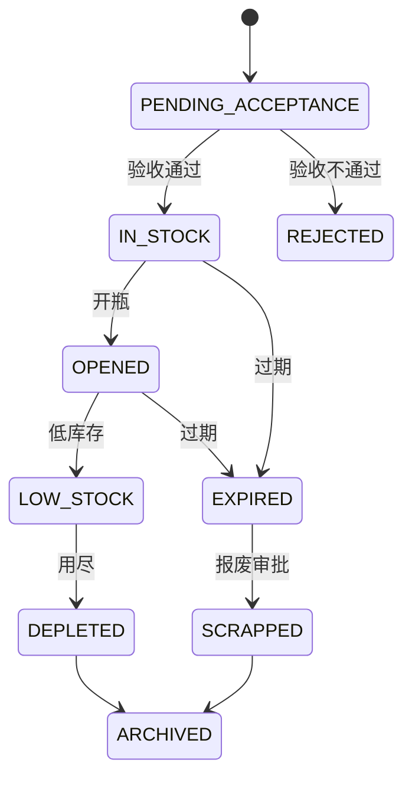

## 11. 统一变更和留样状态机

### 11.1 统一变更申请状态机

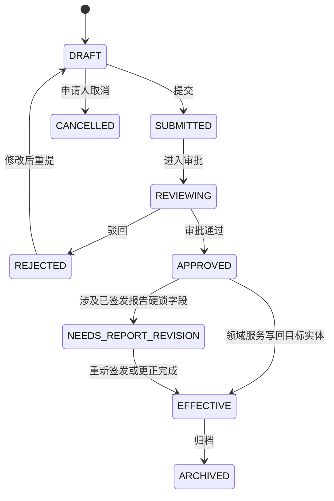

关键 guards：

- 目标字段命中 `HARD_LOCK` 且报告已签发时，不允许直接 `APPROVED -> EFFECTIVE`。
- 目标字段命中 `CHANGE_REQUEST` 时，必须存在审批记录后才能生效。
- 变更生效只能由领域服务写回目标实体，并同步写 `audit_log`。

### 11.2 留样状态机

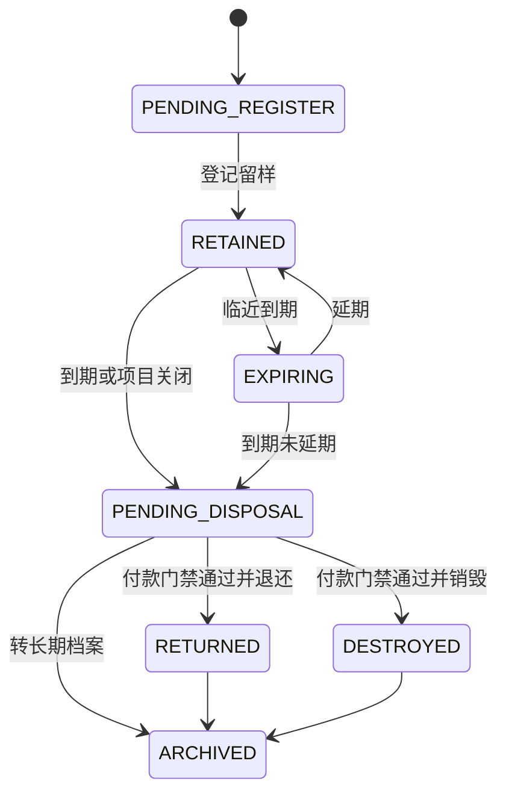

关键 guards：

- 退还或销毁仍受项目付款门禁控制。
- 销毁和退还必须上传凭证或记录处理说明。
- 延期必须记录新的 `retain_until` 和原因。

## 12. 跨实体状态联动

| 触发实体 | 触发事件 | 受影响实体 | 动作 |
| --- | --- | --- | --- |
| `submission` | 内部受理并拆分项目 | `project` | 按检测项目或业务拆分规则创建项目，复制 GLP、样品、客户和制造商信息 |
| `project` | 非标评审通过 | `project` | 状态从 `NONSTANDARD_REVIEW` 进入 `QUOTABLE`，允许报价 |
| `sample` | 所有必需样品核验通过 | `project` | 若项目处于 `WAITING_SAMPLE`，推进到 `SAMPLE_RECEIVED` |
| `study_plan` | 审批通过且资料完备 | `work_order` | `READY_TO_DISPATCH -> DISPATCHED` 时批量生成工单 |
| `work_order` | 项目下所有必需工单 `COMPLETED` | `project`、`report` | 项目进入 `REPORTING`，自动创建 `PENDING_GENERATE` 报告任务 |
| `raw_record` | 审核通过 | `work_order` | 工单可进入 `COMPLETED`，并允许报告字段映射读取 |
| `report` | 授权签发 | `project` | 若未到账，项目进入 `PAYMENT_HOLD` |
| `report` | 发起重新签发 | `report_version`、`report` | `current_version_no` 加 1，创建新 `report_version` 草稿，报告进入 `REVISION_DRAFT` |
| `payment_receipt` | 登记或冲销 | `project`、`report`、`sample` | 重算付款状态；满足条件时解锁正式报告下载和样品处置 |
| `green_channel_request` | 审批通过 | `report` | 仅将报告门禁改为 `GREEN_UNLOCKED`，不改项目为已付款 |
| `report` | 正式发放 | `archive_item` | 自动生成报告归档项，保存版本、签章和发放日志 |
| `sample_return` | 退还或销毁完成 | `sample` | 样品进入 `RETURNED` 或 `DISPOSED`，生成归档记录 |
| `change_request` | 变更生效 | 目标实体、`audit_log`、`archive_item` | 按字段级 diff 写回目标实体，保存审批和变更快照 |
| `sample_retention` | 留样到期或处理完成 | `sample`、`archive_item` | 生成留样处理归档，必要时触发样品处置 |
| `report_delivery_log` | 正式报告发放或批量下载 | `archive_item`、`audit_log` | 记录发放行为和文件版本 |
| `device_file` | 证书即将到期 | `work_center`、通知 | 生成设备文件到期提醒 |
| `import_export_task` | 批量导入或导出完成 | `audit_log`、相关业务表 | 写入任务结果、错误清单和审计记录 |

实体状态唯一可信源是业务表状态字段。审批候选人、审批结论和审批历史以 `approval_record` 为准，不允许引入外部流程引擎作为状态主源。
